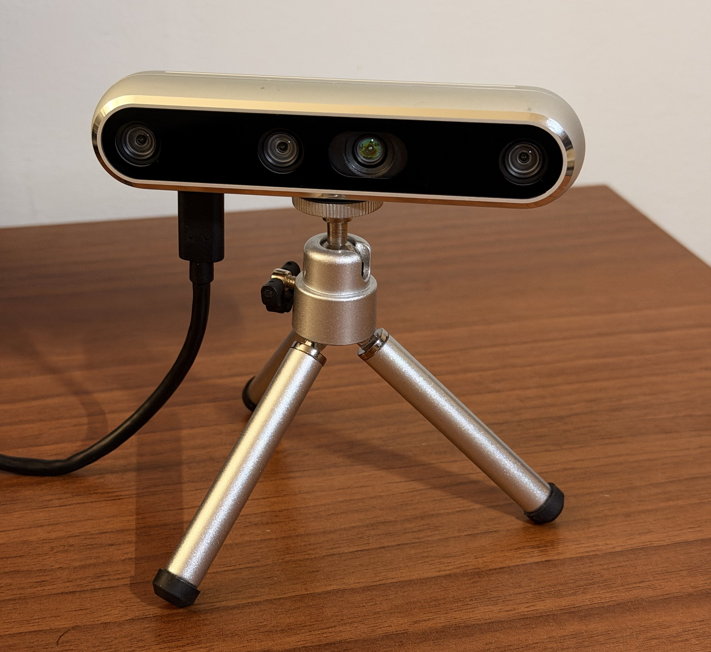
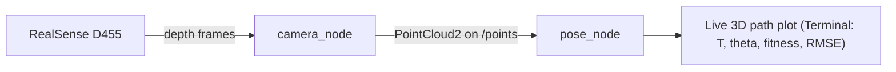

# Realsense Depth Camera Pose Tracking with ICP

Track the motion of an Intel RealSense D455 in real time, using only its depth data. One ROS 2 node streams the 3D points from the camera, a second one aligns consecutive frames with ICP and reports how the camera moved (translation and rotation), while a live plot draws the path.

## Contents

- [Realsense Depth Camera Pose Tracking with ICP](#realsense-depth-camera-pose-tracking-with-icp)
  - [Contents](#contents)
  - [Demo](#demo)
  - [The camera](#the-camera)
  - [How it works](#how-it-works)
  - [Setup](#setup)
  - [Usage](#usage)
  - [Configuration](#configuration)
  - [Tested environment](#tested-environment)
  - [Limitations](#limitations)
  - [Repository structure](#repository-structure)
  - [License](#license)

## Demo

<!-- TODO: add the thumbnails to docs/ and the video links -->

Work in progress...

## The camera

The project uses an Intel RealSense D455, an active infrared stereo camera.

<p align="center">
  
</p>

| | |
|---|---|
| Depth technology | Active IR stereo, global shutter |
| Depth resolution | Up to 1280 x 720, up to 90 fps |
| Depth field of view (H x V) | 86° x 57° (±3°) |
| Stereo baseline | 95 mm |
| Ideal range | 0.6 to 6 m |
| Minimum depth distance | About 0.4 to 0.5 m (around 52 cm at 1280 x 720) |
| Depth accuracy | Under 2% at 4 m |
| RGB sensor | Up to 1280 x 800, global shutter |
| IMU | Bosch BMI055 (some units report BMI085) |
| Interface | USB 3.1 Gen 1, Type-C |
| Size | 124 x 29 x 26 mm |

Figures are from the [Intel product page](https://www.realsenseai.com/products/real-sense-depth-camera-d455f/) and retailer datasheets.

## How it works



**camera_node** reads the depth frames, turns each one into 3D points (x, y, z in meters) and publishes one cloud every *n* frames, where *n* is a tunable parameter. Pixels with no depth are dropped. If the camera stops delivering frames, it logs a warning and keeps running.

**pose_node** does the tracking. It waits until you press Enter, and the first cloud after that becomes the reference. For every new cloud:

1. **Preprocessing:** points farther than 4 m are cropped (depth noise grows with distance), then the cloud is downsampled to 1 cm voxels and isolated noise points are removed.
2. **ICP:** ICP (*Iterative Closest Point*) pairs each point with its closest neighbor in the previous cloud and finds the rigid motion that aligns the two. This uses point-to-plane matching with a Huber loss to limit the effect of outliers, and runs at three scales, from coarse to fine, so large jumps are caught first and then refined. The starting guess for each frame is the previous frame-to-frame motion.
3. **Quality check:** if the match fails (no correspondences, or fitness below the threshold), the frame is skipped and the previous cloud stays as the reference.
4. **Pose update:** the motion of each step is chained onto the total pose, which is relative to the starting position. The node prints the position (x, y, z in meters), the rotation as three Euler angles in degrees, the fitness, the RMSE and the processing time.
5. **Plot:** the path is drawn live in a separate window.

Coordinates follow the RealSense convention at the start position: x to the right, y down, z forward. The plot remaps them so that up is up: x right, y forward, z up.

## Setup

**Needed**

- Linux (Ubuntu recommended) on x86_64 or ARM64. A virtual machine also works, as long as the camera can be passed through to it over USB 3.
- An Intel RealSense D455, on a USB 3 port with a USB 3 cable
- ROS 2, installed following the [official guide](https://docs.ros.org/)
- librealsense with Python bindings
- Python 3 and the packages in `requirements.txt`

**1. System packages**

```bash
sudo apt install git cmake build-essential pkg-config python3-dev python3-venv python3-tk \
    python3-colcon-common-extensions libssl-dev libusb-1.0-0-dev libgtk-3-dev \
    libglfw3-dev libgl1-mesa-dev libglu1-mesa-dev
```

**2. librealsense**

```bash
git clone https://github.com/IntelRealSense/librealsense.git ~/librealsense
```

If pip has a `pyrealsense2` wheel for your platform and Python version (usually x86_64), skip the build below and install the wheel in step 4. Otherwise, for example on ARM64, build the Python bindings from source with the RSUSB backend. Run this with no virtual environment active:

```bash
cd ~/librealsense
mkdir build && cd build
cmake .. -DFORCE_RSUSB_BACKEND=true -DBUILD_PYTHON_BINDINGS=bool:true \
         -DPYTHON_EXECUTABLE=$(which python3) -DCMAKE_BUILD_TYPE=Release
make -j2
```

**3. Camera permissions**

Allow your user to open the camera without `sudo`, then unplug and re-plug the camera:

```bash
sudo cp ~/librealsense/config/99-realsense-libusb.rules /etc/udev/rules.d/
sudo udevadm control --reload-rules && sudo udevadm trigger
```

**4. Python environment**

```bash
python3 -m venv --system-site-packages ~/venv
source ~/venv/bin/activate
pip install -r requirements.txt
```

The `--system-site-packages` flag keeps `rclpy` visible inside the environment. If you skipped the source build in step 2, also run `pip install pyrealsense2`.

**5. Clone and build**

```bash
mkdir -p ~/ros2_ws/src && cd ~/ros2_ws/src
git clone https://github.com/zenna7/from-3D-points-to-ROS2.git
cd ~/ros2_ws
colcon build --symlink-install --packages-select icp_pose
```

With `--symlink-install`, later edits to the Python files take effect without rebuilding.

**6. Load everything when the environment starts**

`ros2 run` launches the system Python, so it has to be told where the environment's packages are. Adjust `lyrical` and `python3.14` to your versions:

```bash
cat >> ~/venv/bin/activate << 'EOF'
export PYTHONPATH=$PYTHONPATH:$HOME/venv/lib/python3.14/site-packages
export PYTHONPATH=$PYTHONPATH:$HOME/librealsense/build/Release
export LD_LIBRARY_PATH=$LD_LIBRARY_PATH:$HOME/librealsense/build/Release
source /opt/ros/lyrical/setup.bash
source $HOME/ros2_ws/install/setup.bash
EOF
```

The two `librealsense/build/Release` lines are only needed if you built from source in step 2.

**7. Check the camera**

```bash
source ~/venv/bin/activate
python -c "import pyrealsense2 as rs; print(len(rs.context().query_devices()), 'device(s)')"
```

It should print `1 device(s)`. If you use a virtual machine, attach the camera to it first. It may need to be re-attached after the stream starts or stops.

## Usage

Open two terminals. In each one:

```bash
source ~/venv/bin/activate
```

Terminal 1, the camera:

```bash
ros2 run icp_pose camera_node
```

Terminal 2, the pose estimation:

```bash
ros2 run icp_pose pose_node
```

Place the camera where you want to start, then press Enter in the `pose_node` terminal. Stop each node with Ctrl+C.

| Where | Key | What it does |
|---|---|---|
| `pose_node` terminal | Enter | Start tracking, then pause or resume |
| Plot window | `0` | 3D view |
| Plot window | `1` | Top view |

When you resume after a pause, the next frame becomes the new reference. Movement during the pause is not tracked. Click on the plot window first, so it has focus for the keys. Possibility of adding views via the `VIEWS` dictionary in `pose_node.py`.

## Configuration

Both nodes have a `CONFIG` dictionary at the top of the file.

**camera_node.py**

| Key | Default | Meaning |
|---|---|---|
| `width`, `height` | 640, 480 | Depth stream resolution |
| `fps` | 30 | Camera frame rate |
| `publish_every` | 6 | Publish one cloud every N frames (30 / 6 = 5 Hz) |
| `debug` | `False` | Also stream color and show a video window |

**pose_node.py**

| Key | Default | Meaning |
|---|---|---|
| `pre_voxel` | 0.01 m | First downsampling of every incoming cloud |
| `max_depth` | 4.0 m | Farther points are dropped |
| `min_points` | 1000 | Clouds with fewer points are skipped |
| `min_fitness` | 0.3 | Matches below this fitness are skipped |
| `tolerance` | 1e-6 | ICP stops when the improvement is smaller than this |
| `scales` | see file | Per scale: voxel size, maximum pairing distance, iterations |

Faster hand movements need larger pairing distances at the coarse scales. A slow machine needs a larger finest voxel or fewer iterations. The processing time per frame is printed at the end of every result line.


## Tested environment

| | |
|---|---|
| Host | MacBook Pro, Apple M1, 8 GB RAM |
| Virtual machine | UTM 5.0.8 (QEMU 10.0 ARM virtual machine), 4 CPU cores, 4 GB RAM, 29.5 GB disk |
| Guest OS | Ubuntu 26.04.1 LTS (ARM64) |
| ROS 2 | Lyrical |
| Python | 3.14.4 |
| librealsense | 2.59.1, built from source with the RSUSB backend |
| Camera | Intel RealSense D455, firmware 5.17.0.10, USB 3.2 link passed through to the VM |
| Python packages | numpy 2.3.5, scipy 1.18.1, open3d 0.20.0, matplotlib 3.10.7, opencv-python 5.0.0.93 |


## Limitations

- **Static scenes only:** ICP assumes the scene does not move, so a person or object moving in view pulls the estimate with it.
- **Drift:** each frame is matched to the previous one and the errors add up. There is no loop closure, so a path that returns to its start will not close exactly.
- **Weak geometry:** a flat wall or floor does not constrain the movement along its surface. Scenes with objects and corners work best.
- **Axes come from the start:** the origin and axes are the camera's pose when tracking starts. They are not aligned with gravity or the room.
- **Close range:** the D455 cannot measure closer than about half a meter.
- **Fast motion:** large jumps between frames can make ICP fail. Move the camera slowly.
- **Geometry only:** color and the IMU are not used.


## Repository structure

```
icp_pose/        the two nodes: camera_node.py and pose_node.py
resource/        ament marker file, needed by ROS 2
offline/         the original offline reconstruction script 
initial_test/    test code for the start of the project, useless now
package.xml      ROS 2 package description
setup.py         Python package and entry points
setup.cfg        install paths
requirements.txt pip dependencies
```

## License

MIT, see [LICENSE](LICENSE).
